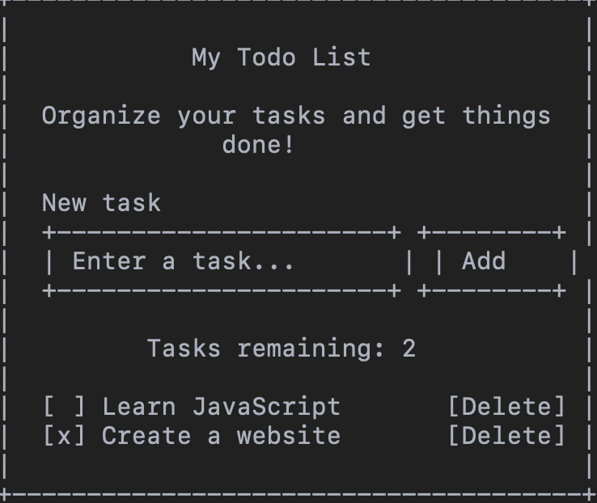
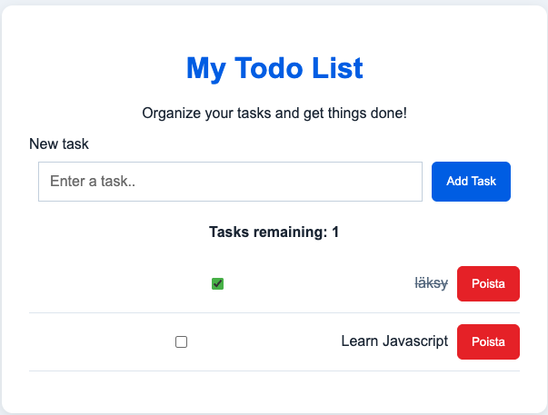

MY Todo List
1. Projektin esittely

Tässä projektissä tein yksinkertaisen tehtävälistasovelluksen. Sovelluksessa käyttäjä voi lisätä omia tehtäviä, merkitä niitä tehdyiksi ja poistaa tehtäviä listalta.

Halusin tehdä sovelluksesta selkeän ja helppokäytöisen. Tehtävät tallentuvat selaimeen, joten ne säilyvät myös silloin, kun sivu päivitetään.

2. Projektin tavoitteet

Projektin tavoitteena oli harjoitella JavaScriptin käyttöä ja HTML-elementien käsittelyä.

Tavoitteena olivat:

. Tehdä toimiva tehtäväsovellus
. Harjoitella JavaScriptin käyttöä
. Oppia käsittelemään käyttäjän syötteitä
. Tallentaa tehtävät selaimen muistiin
. Tehdä sovelluksesta selkeä ja helppokäyttöinen

3. Projektin suunnitelma

Aloitin projektin tekemällä HTML-rakenteen, sen jälkeen muotoilin sivun CSS:n avulla ja lisäsin toiminnalisuudet JavaScriptillä.

Projektin työvaiheet:
1. HTML-rakenteen tekeminen
2. Sivun ulkoasun suunnitelu ja toteutus CSS:llä
3. Tehtävien lisäämisen toteuttaminen
4. Syötteen tarkastamisen lisääminen
5. Tehtävien tallentaminen localStorageen.
6. Sovelluksen testaaminen
7 Projektin julkaiseminen github pagesissa

4. Rautalankamalli
Sovelluksen  suunnitelmä oli yksinkertainen näkymä, jossa on otsikko, tekstikenttä uuden tehtävän  kirjoittamista varten, lisäämispainike ja tehtävälista.

Tehtävien yhteydessä näkyvät myös tehtävien valintaruudut ja poistopainikkeet.

5. Sovelluksen ominaisuudet
 
 Sovelluksessa voi:
 - lisätä uusia tehtäviä
 - tarkistaa, että tehtävän tekstissä on vähintään kolme merkkiä
 - Merkitä tehtäviä tehdyiksi valintaruudun avulla
 - Poistaa tehtäviä listalta
 - Nähdä, kuinka monta tehtäviä on vielä tekemättä
 - Tallentaa tehtävät selaimen muistiin
 - Nähdö tallennetut tehtävät, kun sivu avataan uudelleen

 6. Kuvakaappaukset:

 Alla on kuvakaappaus valmiista sovelluksesta

Kuvasta näkyy sovelluksen ulkoasu ja tehtävälistan toiminta.

 7. Mitä opin projektin aikana

 Projektin aikan opin lisää JavaScriptin käytöstä ja siitä, miten HTML-elementtejä voidaan käsitellä koodin avulla.

 Harjoittelin tapahtumankäsittelyä, käyttäjän syötteiden tarkistamista ja sivun sisällön päivittämistä. Opin myös käyttämään LocalStragea, jotta tehtävät säilyvät sivun päivittämisen jälkeen.

 8. Lähteet ja tekoälyn käyttö

 Tekoälyn käyttö: käytin Chatgpt:tä apuna javascriptin ymmärtämisesssä ja virheiden etsimisessä. Testasin sovellusta projektin aikana ja korjasin koodia vaihteittain.

9. Linkit
. Github-repositorio: https://github.com/osm177/Projekti_1_DOM_Skriptaus
. Julkaistu sovellus: https://osm177.github.io/Projekti_1_DOM_Skriptaus/
. esittelyvideo: tähän